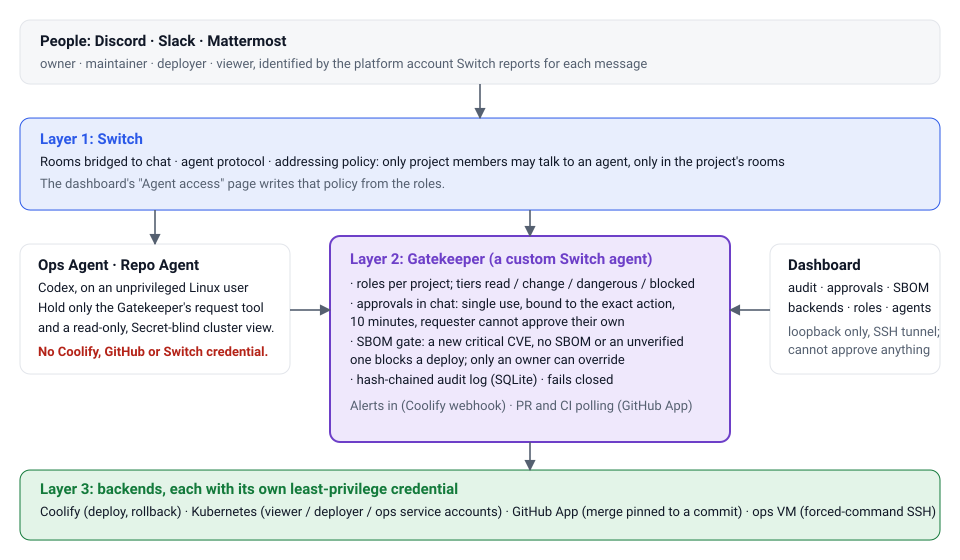

# Shipyard

**A chat room that ships software, and can't be talked into doing anything it shouldn't.**

Shipyard turns a Discord, Slack or Mattermost channel into an ops room for a small team. People ask for deploys, rollbacks, logs, pull-request status and merges in plain chat. Two AI agents (an Ops Agent and a Repo Agent) answer and diagnose. Every change goes through one small program, the **Gatekeeper**, which checks who is asking, asks a second person for approval when it matters, blocks deploys that bring in a new critical vulnerability, and writes an audit log nobody can quietly edit.

Built for the [Flip the Switch hackathon](https://www.wemakedevs.org/hackathons/switch) (WeMakeDevs × DevTools Academy × Switch), Track 2, also entered in Track 1.



## What it looks like

Condensed from real runs; the merge exchange at the end is exactly what the Gatekeeper said.

```text
anya      @gatekeeper deploy demo-web
gatekeeper Done: deploy demo-web for anya. deployment queued.

coolify   ALERT: deployment failed for demo-web  (last 40 log lines, secrets removed)
ops-agent The build fails at line 4: requirements.txt is not in the image. Options: roll back, or fix the COPY.
rahul     @gatekeeper rollback demo-web
gatekeeper Approval needed (id 9a3d745b): rollback demo-web, requested by rahul. An owner can reply `@gatekeeper approve 9a3d745b`.
owner     @gatekeeper approve 9a3d745b
gatekeeper Done: rollback demo-web for rahul, approved by owner.

maintainer @gatekeeper merge 7
gatekeeper BLOCKED by the SBOM gate (id ab516adc): merge PR #7, requested by maintainer. 6 new critical CVEs:
           CVE-2019-14234 in pypi/django 2.2 … Only an owner can override: `@gatekeeper approve ab516adc`.
maintainer @gatekeeper approve ab516adc
gatekeeper Denied: only an owner can override a security block.
owner     @gatekeeper approve ab516adc
gatekeeper Done: merged PR #7 (squash, ded6a31), approved by owner. Deploy of demo-web queued.
```

The merge exchange ran on a build VM against a real repository and a real Grype scan. The audit log kept the block, the refused approval and the override, with the CVE ids.

## How Switch is used

[Switch](https://github.com/sandbox-quantum/switch) is the chat layer, and Shipyard leans on it for more than message transport:

| Switch feature | What Shipyard does with it |
|---|---|
| **Bridges and rooms** | One room group per project (ops and maintainers rooms), mirrored to Discord and Mattermost. Slack works through the same bridge mechanism but is untested here. |
| **Agent protocol** | The Gatekeeper is itself a *custom Switch agent*: it holds a stream open, sends heartbeats, reads messages and posts replies and alerts. Nothing else listens to your rooms. |
| **Templates** | The whole project is one Switch template, [`templates/shipyard.template.yaml`](templates/shipyard.template.yaml): the Ops and Repo agents, a room group with an ops, an incidents and a maintainers room, and the links between them. `shipyard init` runs it through Switch's template API; Switch Console can run the same file from its Templates page. |
| **Agent controller** | The Ops Agent and Repo Agent are Codex agents run by a Switch controller on your machine. The template creates them, or reuses the ones Switch already has. |
| **Sender identity** | Each message carries the sender's platform account (`@switch-discord-<bridge>-<name>:localhost`). Roles and approvals are tied to that, so "who said approve" is not something a message can claim. |
| **Addressing policy** | Switch itself refuses messages to an agent from people outside the project, and only in the project's rooms. The dashboard's *Agent access* page rebuilds that policy from the roles. |

## What it does

| Area | Commands (mention `@gatekeeper`) | Who |
|---|---|---|
| Read | `status`, `logs`, `events`, `prs`, `pr <n>`, `digest`, `suggestions <pr>`, `sbom [pr\|commit\|release-tag\|app\|live]`, `audit [n]`, `whoami` | viewer and up |
| Change | `deploy`, `restart`, `rollback` (approval), `scale` (Kubernetes) | deployer and up |
| Diagnose | `exec <app> <command>`: one of about 50 read-only commands inside the app's Coolify container or Kubernetes pod (`ls`, `cat`, `tail`, `grep`, `ps`, `df`, `curl http://localhost:PORT/health`, a runtime's `--version`, ...). No shell, no writes, no deletes, no environment, no credential files. | maintainer and up |
| Dangerous | `merge <pr>`, `apply-suggestion <pr> <n\|all>` (a reviewer's suggested change, committed to the PR branch), `shell <host> <cmd>` (owner) | maintainer / owner, plus a second person's approval |
| Approve | `approve <id>`, `deny <id>` | owner, or another maintainer |
| Automatic | deploy-failure and crash **alerts** with real log evidence and a three-line diagnosis; **PR alerts** (opened, CI red or green, conflicts, stale); a **daily digest** per maintainer | |
| Security | an **SBOM report** for every CI run, diffed against the last deployed release, posted in the maintainers and ops rooms with the deploy plan; critical CVEs **gate** the deploy; new copyleft or unknown **licences** are flagged (report only) | owner overrides |
| Dashboard | audit log, pending approvals, SBOM reports, backend health, roles and agent access | owner edits roles |

Commands are mentions, never a `!` prefix, because Switch uses `!` for its own commands.

## Install

You need a machine that already runs **Switch** (with its admin login in `~/switch/.env`); on a blank Ubuntu machine, `scripts/install-switch.sh` sets one up with Docker and the bundled Mattermost. A brand-new Switch has no rooms, so `init` creates `<project>-ops` and `<project>-maintainers` for you. Coolify, a GitHub App and a Kubernetes cluster are optional; Shipyard asks about each and skips what you leave blank.

```bash
curl -fsSL https://raw.githubusercontent.com/Shrinet82/shipyard/main/scripts/install.sh | bash
```

That installs Python, PyYAML, OpenSSL and git with apt, clones this repository to `~/shipyard` and runs `python3 -m shipyard init`, which:

1. logs in to Switch and **lists your rooms**, so you pick them by number;
2. asks for your Coolify URL and token (typed hidden), **lists your applications** and lets you choose;
3. checks the GitHub App can see your repository **before** writing anything;
4. writes `~/shipyard.yaml` and the secret files (all mode `0600`), registers the Gatekeeper in Switch and adds it to the rooms;
5. runs the Shipyard **Switch template**: the project's three rooms and the links between them, and the Ops and Repo agents (reused if Switch has them, otherwise created on your controller, which needs Codex installed and signed in); the agents get **only** the Gatekeeper's tool;
6. installs and starts a systemd user service, then runs `doctor` and prints what is left to do.

After it finishes:

```bash
# 1. in a Shipyard room, type:  @gatekeeper whoami   and copy the id it prints
python3 -m shipyard add-owner --identity '<that id>'      # once, on the machine
# 2. in Coolify: Notifications → Webhook → the URL that this prints
python3 -m shipyard webhook-url --host <this machine's private address>
# 3. any time, to see what is wrong:
python3 -m shipyard doctor
```

Everything can also run without questions: `python3 -m shipyard init --answers answers.yaml` (see [`docs/answers.example.yaml`](docs/answers.example.yaml)), and `--dry-run` checks every credential and prints the config without writing a file.

**Getting the pieces** (each is a one-time job; the steps that worked are in [`docs/PHASE0-FINDINGS.md`](docs/PHASE0-FINDINGS.md) and [`docs/PHASE2.md`](docs/PHASE2.md)):

- *Switch*: run the server in Docker, enable `agent_management`, connect Discord or use the bundled Mattermost, and enroll a controller if you want the agents.
- *GitHub App*: webhooks **off**; repository permissions Contents (read and write), Pull requests (read and write), Actions (read), Checks (read), Commit statuses (read), Issues (read). Install it on the one repository.
- *CI*: add the `sbom` job from [`shipyard-demo`'s workflow](https://github.com/Shrinet82/shipyard-demo/blob/main/.github/workflows/ci.yml) (Syft and Grype, actions pinned by commit). Mark `test` and `sbom` as required checks.
- *Kubernetes (optional)*: `deploy/k8s/` has the RBAC and a workload; `scripts/k8s_kubeconfigs.sh` makes the three least-privilege kubeconfigs.
- *Production shell (optional)*: `deploy/ops-shell/install.sh` sets up the forced-command SSH key.

## The dashboard

It listens on `127.0.0.1:8780` only. Reach it through a tunnel:

```bash
scripts/vm.sh tunnel        # or: ssh -L 8780:localhost:8780 <machine>
```

Open `http://localhost:8780`, click **Get a sign-in code**, and type `@gatekeeper dashboard-login <code>` in a Shipyard room. Switch tells the Gatekeeper who sent it, so the session belongs to that person and their role. No password and no token is ever posted in chat. (`python3 -m shipyard dashboard-token` prints a token for whoever has a shell on the machine.)

It shows everything and can change two things, for owners only and both audited: **roles** and **agent access** (Switch's addressing policy, with a preview before anything is applied). It has no approve button on purpose.

## Security model

The agents are language models reading text from strangers (PR descriptions, logs, chat). The design assumes they can be fooled, and makes that harmless:

1. **Agents can't act.** They hold no credential for Coolify, GitHub, the cluster or Switch, and run as an unprivileged Linux user with the platform's secrets out of reach. They can only ask the Gatekeeper, citing the human message that asked. A proposal always waits for a human's approval, and an agent's own "approve" is ignored and logged.
2. **Identity comes from Switch**, not from the message text. A role is bound to the platform account that sent it.
3. **Approvals are single use**, bound to the exact action, target and arguments (and, for deploys and merges, the **commit**), expire in 10 minutes, and can't be given by the person who asked (except an owner, or the person an agent acted for).
4. **Chat text never reaches a shell.** Commands are parsed by a fixed grammar; backends are driven with argument lists; names, namespaces and replica counts are validated. Logs and command output are redacted, stripped of mentions and shown as data.
5. **The SBOM gate** blocks a forward deploy on a new critical CVE, a missing SBOM or an unverified one. Only an owner can override, pinned to the commit. Rollbacks are never gated. A pull request that edits `.github/workflows/` can't vouch for its own SBOM, so it is "unverified".
6. **Least privilege per backend**: three Kubernetes service accounts (the agents hold only the one that can't read Secrets), a GitHub App with merge pinned to the approved commit, an SSH key locked to one forced command.
7. **The audit log is hash-chained** in SQLite; an edited row breaks the chain and the dashboard says so.
8. **Fail closed**: if GitHub, Switch or the scan can't be reached, the answer is "no", never "assumed fine".

**Residual risks, stated plainly.** CI output is trusted: protect the default branch (required reviews, CODEOWNERS on `.github/`), because anyone who can change the workflow can change what the SBOM says. A deploy builds the branch as Coolify finds it, which can be newer than the commit judged; the approval is pinned and a moved head is refused just before it runs, but a small window remains. Anyone with a shell on the machine can open the dashboard and read the secret files.

The permission model is tested with attack cases (forged approvals, replays, agents approving, hostile package and log text, path tricks, bad zips, cross-origin requests): see `tests/`.

## Repository layout

| Path | What |
|---|---|
| `shipyard/policy.py`, `gatekeeper.py`, `audit.py` | roles, tiers, approvals, the hash-chained log |
| `shipyard/service.py`, `commands.py` | the chat commands and the gate |
| `shipyard/coolify.py`, `github.py`, `kube.py`, `hostshell.py` | backend adapters |
| `shipyard/sbom*.py` | SBOM parsing, trust checks, store and collector |
| `shipyard/dashboard.py`, `web/` | the dashboard (standard library and plain JavaScript, no build step) |
| `shipyard/init.py` | the installer and `doctor` |
| `templates/shipyard.template.yaml` | the Switch template: agents, rooms, links |
| `shipyard/suggestions.py` | reading and applying reviewers' suggested changes |
| `docs/` | the scope and results of each phase, pinned tools, the architecture image |

```bash
python3 -m pip install pyyaml pytest
python3 -m pytest        # 775 tests, no network
```

## Status

Built in five phases during the hackathon, then extended. Verified live on Mattermost: alerts, approvals, rollback, merge and deploy, Kubernetes, shell, the SBOM gate, the dashboard, `exec` in a pod, release names, licence flags, and applying a reviewer's suggestion (a commit by the GitHub App to the PR branch, crediting the reviewer). On Discord the commands, approvals, rollback and merge were verified. The installer was run on a clean Ubuntu VM (t3.large, then terminated): Switch's stack took about 6 minutes to pull and start, `scripts/install.sh` 25 seconds, and from `whoami` to the owner's first real command 16 seconds; that run found and fixed three bugs.

`exec` in a **Coolify container** is built and tested (the forced-command wrapper and a root-owned helper in `deploy/ops-shell/`, reached through one sudo rule for the `shipyard-ops` account), but its helper has not yet been installed on the demo Coolify VM, so that path has not run live.

**Future scope:** a Slack run (Switch bridges Slack the same way, but it is untested here); more commands for `exec`, and an `exec` that is allowed to write (today nothing in the list changes anything); applying suggestions from a fork's pull request; per-release SBOM history on the dashboard.
