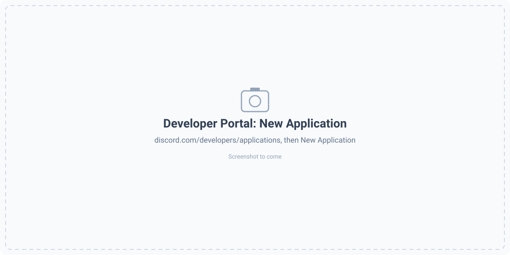
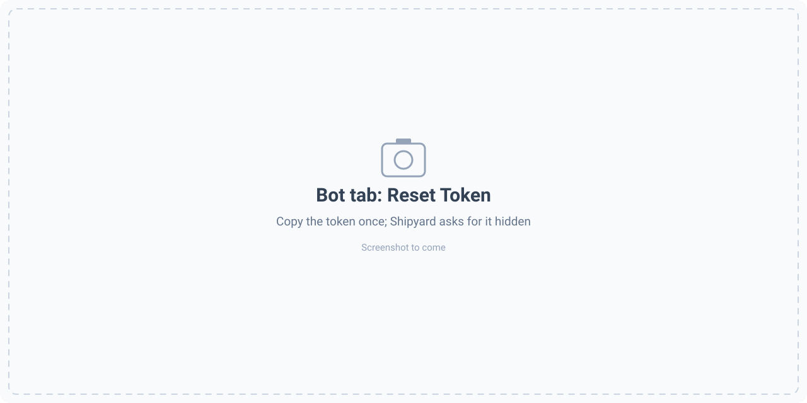
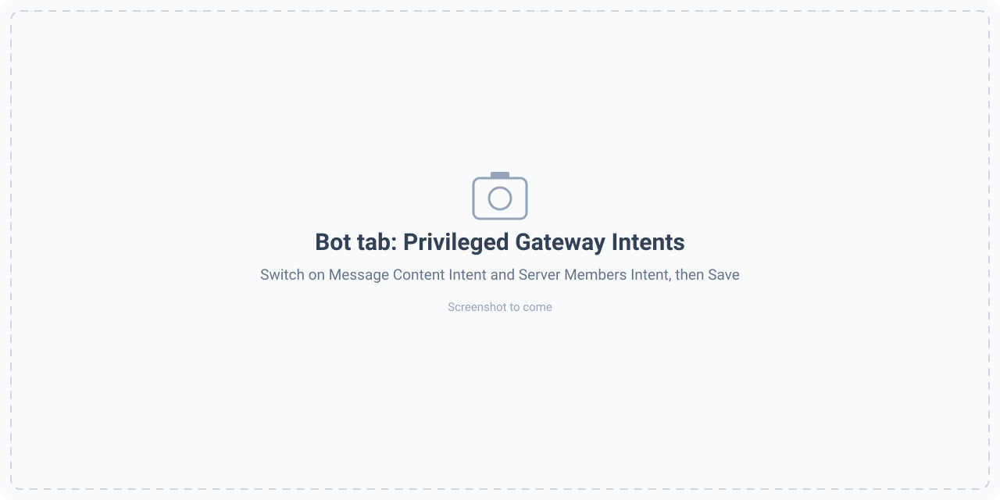
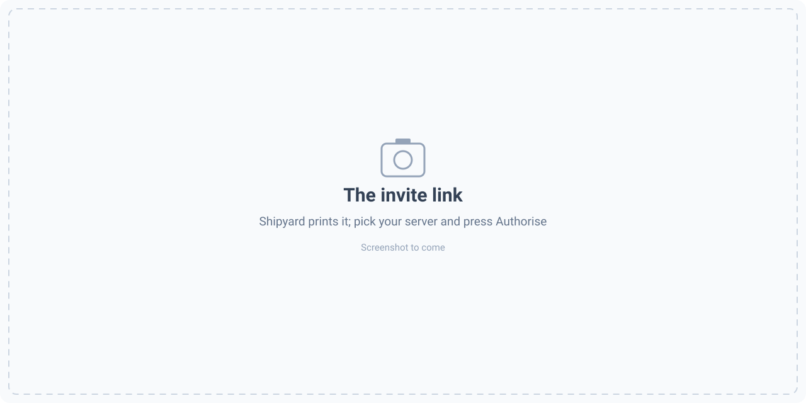
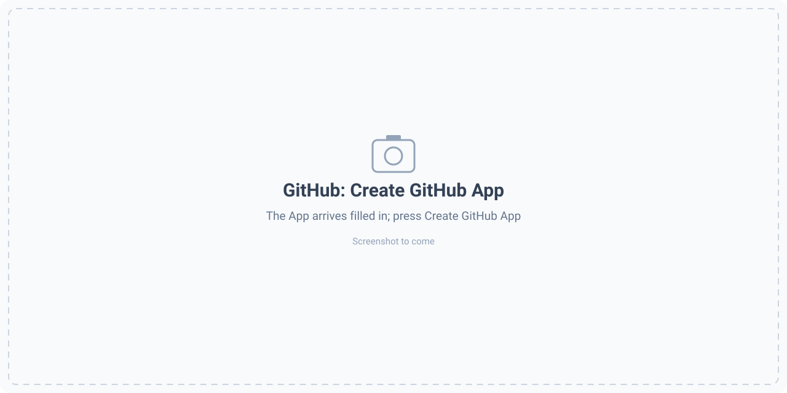
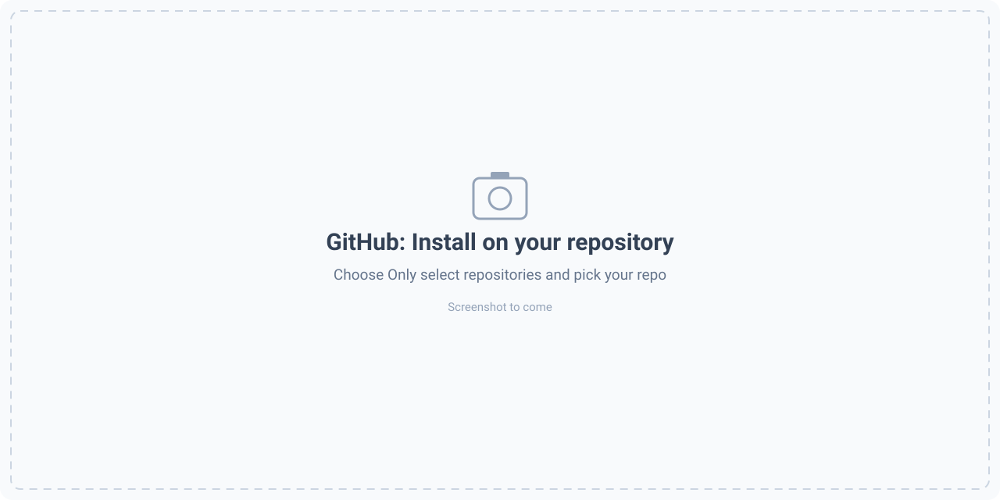
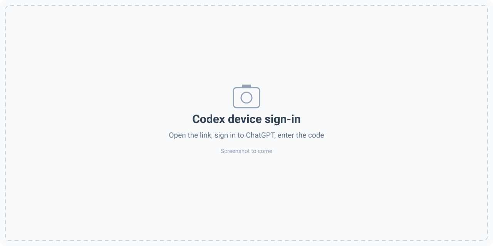
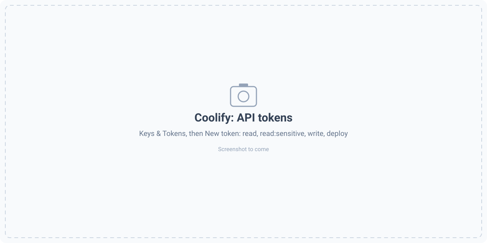
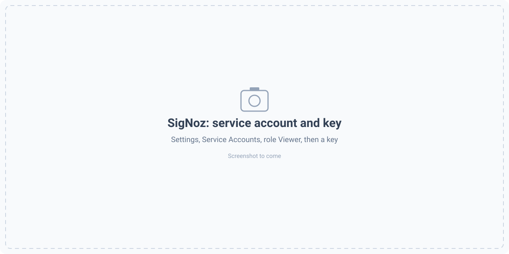

# Setup guides: the things only you can do

The installer does everything a machine can do. These are the few steps it can't, each with the exact clicks. Every guide says what to have in hand, what to do, and what Shipyard checks for you. The screenshots marked *to come* are placeholders until the walkthrough videos are recorded.

- [Get a Discord bot token](#get-a-discord-bot-token)
- [Create the GitHub App (two clicks)](#create-the-github-app-two-clicks)
- [Sign in to Codex](#sign-in-to-codex)
- [Create a Coolify API token](#create-a-coolify-api-token)
- [Create a SigNoz key](#create-a-signoz-key)
- [Open the pages from your browser](#open-the-pages-from-your-browser)

---

## Get a Discord bot token

You need: a Discord account and a server where you can add a bot (you own it, or have *Manage Server*). About three minutes.

**1. Create the application.** Open the [Discord Developer Portal](https://discord.com/developers/applications), press **New Application**, name it (for example `Shipyard`) and accept the terms.



**2. Copy the bot token.** In the left menu choose **Bot**, press **Reset Token** and copy it. Discord shows it once; if you lose it, reset it again. Treat it like a password: Shipyard asks for it hidden and keeps it in a file only you can read (`~/discord.env`).



**3. Switch on two toggles.** Still on the **Bot** page, scroll to **Privileged Gateway Intents** and switch **on**:

- **Message Content Intent**, otherwise the bot receives empty messages;
- **Server Members Intent**, so Switch can tell people apart.

Press **Save Changes**. Shipyard reads these switches back from Discord and tells you which one is still off.



**4. Run the Discord step.** It is part of the installer, or on its own:

```bash
python3 -m shipyard connect discord
```

Paste the token when asked (nothing is shown as you type). Shipyard checks it with Discord straight away.

**5. Press the invite link.** Shipyard prints a link that already names your bot and asks only for the permissions the bridge uses (never *Administrator*). Open it, pick your server, press **Authorise**. Shipyard waits until the bot appears in a server, so there is **no server id to copy**. With several servers it asks which one.



**6. Become the owner there.** Shipyard connects the server to Switch, makes `#<project>-ops`, `-maintainers` and `-incidents`, and waits. Open `#<project>-ops` and type `@gatekeeper whoami`; the terminal asks "make them an owner?" and you answer `yes`.

If something fails: *"Discord does not accept this bot token"* means the token was copied wrong or was reset since; *"Message Content Intent is still off"* means step 3 was not saved.

---

## Create the GitHub App (two clicks)

You need: a GitHub account and a repository. Shipyard makes the App for you with GitHub's manifest flow, so there is no form to fill and no key to copy.

```bash
python3 -m shipyard github-app --repo owner/name        # add --org my-org to own the App under an organisation
```

**1. Open the address it prints** (`http://localhost:8767/`, or your machine's address if you gave one). On a remote machine without that, first run `ssh -L 8767:localhost:8767 <machine>`.

**2. Press Create GitHub App.** GitHub shows the App already filled in: its name, permissions (contents and pull requests read and write; actions, checks, statuses, issues read) and events. The keys come back to Shipyard and are saved (mode 0600).



**3. Press Install** and choose **Only select repositories**, then your repository. Shipyard waits until the App can see it and writes it into the config.



The installer does this for you at the GitHub step. If it stops partway, run it again: it finds the App it already made and offers to use it instead of creating another.

---

## Sign in to Codex

You need: a ChatGPT account. The Ops and Repo agents run on Codex, sealed off from your secrets as a separate Linux user, so the sign-in is for that user.

The installer runs the sign-in for you. By hand:

```bash
sudo -u agentrun -H codex login --device-auth
```

Open the link it prints (`https://auth.openai.com/codex/device`) on any device, sign in, and enter the one-time code. The code is valid for 15 minutes. When the terminal says *Successfully logged in*, press on.



---

## Create a Coolify API token

You need: a running Coolify. The installer asks for its address and the token, checks the token at once, and asks again if it is refused.

1. In Coolify, **Settings**, enable **API access** (and **MCP**).
2. Open `<your Coolify address>/security/api-tokens`, press **New token**, name it, and tick **read**, **read:sensitive**, **write** and **deploy**. Without `read:sensitive`, alerts say "could not fetch logs".
3. Copy the token (shown once) and paste it when the installer asks.



Afterwards, to receive alerts: in Coolify choose **Notifications**, then **Webhook**, and paste the address that `python3 -m shipyard webhook-url --host <this machine's private address>` prints. Tick Deployment failure, Deployment success, Status change, Restart limit reached, Server disk usage and Container restarted.

---

## Create a SigNoz key

Shipyard only reads from SigNoz, so give it a **Viewer** key.

**On a new SigNoz**, let Shipyard do it:

```bash
python3 -m shipyard connect signoz --url http://localhost:8080 --bootstrap
```

It creates the admin account (the login is saved in `~/signoz-admin.env`, mode 0600), a Viewer service account with a one-year key, and an alert that calls Shipyard when any service logs an ERROR.

**On a SigNoz you already use**, create the key yourself: in SigNoz open **Settings**, **Service Accounts**, create one with the **Viewer** role and add a key. Then run `python3 -m shipyard connect signoz --url http://signoz:8080` and paste the key when asked.



---

## Open the pages from your browser

The bundled Mattermost (8065), Switch Console (8000) and the Shipyard dashboard (8780) listen on the machine itself by default. Two ways in:

**An SSH tunnel** (always works). On your own computer:

```bash
ssh -L 8065:localhost:8065 -L 8780:localhost:8780 -L 8000:localhost:8000 <user>@<the machine>
```

then open `http://localhost:8065`.

**Straight from the browser** (the installer offers it at the owner step):

```bash
python3 -m shipyard expose            # --off to undo, --only mattermost to choose
```

Then, in your cloud provider's firewall, allow TCP 8065, 8000 and 8780 **from your own address only**. On AWS: EC2, Security groups, Inbound rules, Add rule, Custom TCP, Source *My IP*. The pages use plain HTTP, so never open them to everyone. The tunnel keeps working either way.
